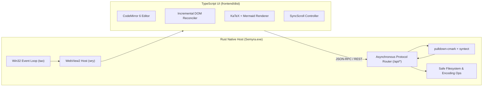

# Semyra

<p align="center">
  <strong>Markdown for the AI era.</strong><br>
  Ein nativer, blitzschneller Windows 11 Markdown-Editor mit synchronisierter Live-Vorschau.<br>
  Entwickelt für Dokumentation, System-Prompts, AI-Skills und Agentenanweisungen.
</p>

<p align="center">
  
  
  
  
  
  
</p>

---

## Produktvorstellung

**Semyra** verbindet die Reaktionszeit und Robustheit einer nativen Win32/Rust-Desktop-Anwendung mit der visuellen Präzision eines modernen Web-Frontends. Anstelle speicherhungriger Electron-Laufzeitumgebungen startet Semyra als **einzelne, kompakte Windows-Binary (`Semyra.exe`)** ohne externe Abhängigkeiten.

Entwickelt für den täglichen Workflow von Software-Ingenieuren, Prompt-Designern und Wissensarbeitern bietet Semyra eine konzentrierte Umgebung für Markdown-Inhalte – von einfachen Notizen über interaktive Checklisten bis hin zu komplexen technischen Spezifikationen mit mathematischen Formeln und Architekturdiagrammen.

---

## Die wichtigsten Highlights

### ⚡ 1. Echte Desktop-Performance ohne Electron
- **Kompakte Standalone-Binary**: Das gesamte Frontend ist zur Kompilierzeit via Rust-Embed in die ~10.8 MB große PE-Executable integriert.
- **Ressourceneffizient**: Minimale RAM-Auslastung und blitzschneller Kaltstart über Microsoft Edge WebView2.
- **Single-Instance & Multi-Window**: Dateien, die im Windows Explorer angeklickt werden, öffnen sich automatisch als neue Tabs im bestehenden Fenster. Mit `--new-window` lässt sich jederzeit ein zweites, isoliertes Instanzfenster starten.

### 🎨 2. Semyra Fluent Design System
- **Konsequenter Dark & Light Mode**: Perfekt abgestimmt auf Windows 11 mit synchronisierter Win32-Titelleiste.
  - **Dark Mode**: *Midnight* (`#12161E`) & *Slate* (`#1A212B`) Hintergründe mit kontrastreichem Text (`#EDF2F5`).
  - **Light Mode**: *Pure White* (`#FFFFFF`) & *Chrome Mist* (`#F3F5F7`) mit tiefem Slate-Text (`#202934`).
- **Neutrale Markdown-Typografie**: Dokumenteninhalte bleiben bewusst ruhig und ermüdungsfrei lesbar. Fett- und Kursivtext differenzieren über Schnitt und Stärke – ohne störende Buntheit.
- **Präzise Interaktionsfarben**:
  - **Steel Blue** (`#83A5C6` Dark / `#426B91` Light): Fokus-Ringe, aktive Tabs, Befehlspalette, Schalter und Tastatur-Highlights.
  - **Amber Status-Indikator** (`#D0A774` Dark / `#986C3D` Light): Ein dezenter, runder Statuspunkt im Tab signalisiert ungespeicherte Änderungen sofort – völlig ohne Layout-Jitter oder Breitenänderungen.

### 🧠 3. Entwickelt für die KI-Ära
- **Perfekt für Agent-Workflows**: Optimiert für das Verfassen und Pflegen von `AGENTS.md`, `PROMPT.md`, `SKILL.md`, Copilot-Regeln und Kontextdateien.
- **Strukturierte Blöcke**: Erstklassige Darstellung von YAML-Frontmatter-Metadaten, GitHub-Alerts (`[!NOTE]`, `[!TIP]`, `[!IMPORTANT]`, `[!WARNING]`, `[!CAUTION]`), Task-Listen und Fußnoten.
- **Mathematik & Diagramme**: Schnelles, flackerfreies Rendering von **KaTeX**-Formeln (`$...$` / `$$...$$`) und interaktiven **Mermaid**-Diagrammen (Flowcharts, Sequenzdiagramme, Klassendiagramme).

### ✍️ 4. Intelligenter CodeMirror 6 Editor
- **Smart Formatting**:
  - Automatische Listenfortsetzung per `Enter` für Aufzählungen (`-`, `*`), nummerierte Listen (`1.`), Aufgabenlisten (`- [ ]`) und Zitatblöcke (`>`). Doppeltes `Enter` beendet die Liste sauber.
  - Interaktive Checkboxen direkt in der Vorschau anklickbar (aktualisieren den Quelltext automatisch).
  - GFM-Tabellenbearbeitung: Navigation per `Tab` und `Shift+Tab` mit automatischer Spaltenausrichtung (`|`).
  - Intelligentes URL-Einfügen: Markierter Text wird beim Einfügen einer Web-URL automatisch zu `[Auswahl](https://...)`.
  - **Integrierter Bild- & Screenshot-Import**: Bilder aus der Zwischenablage (`Strg+V`) oder per Explorer-Drag-&-Drop werden automatisch als optimierte PNG-Dateien unter `./assets/` gespeichert und direkt verlinkt.
- **Code- & Sektions-Folding**: Einklappen von Codeblöcken, Überschriftsabschnitten und YAML-Headern.
- **Multi-Encoding & Zeilenenden**: Verlustfreies Öffnen von `UTF-8`, `UTF-8 BOM`, `UTF-16 LE/BE` und `Windows-1252`-Dateien mit atomarem Speichern (`.semyra-save-*.tmp` + Rename) und direktem `CRLF`/`LF`-Umschalter in der Statusleiste.

### 🔍 5. Arbeitsbereich & Produktivitätswerkzeuge
- **Fuzzy Quick-Open (`Strg+E`)**: Blitzschneller Dateisprung über alle offenen Tabs, Workspace-Dateien und zuletzt geöffneten Dokumente.
- **Befehlspalette (`Strg+Umschalt+P` / `>` in Quick-Open)**: Alle Editor-, Ansichts- und Exportaktionen direkt über die Tastatur erreichbar.
- **Volltextsuche im Workspace (`Strg+Umschalt+F`)**: Schnelle Multi-File-Suche über das Rust-Backend mit Ergebnis-Vorschau und direktem Zeilensprung.
- **Arbeitsbereich-Explorer**: Baumansicht mit Drag-&-Drop, Kontextmenü (Neu, Umbenennen, Explorer-Show) und sicherer Löschung über den **Windows-Papierkorb** (`trash`).
- **Bidirektionales Sync-Scroll**: Pixelgenauer Scroll-Abgleich zwischen Editor und Live-Vorschau mit aktiver Inhaltsverzeichnis-Hervorhebung.
- **Crash-Sicherheit & Entwurfssicherung**: Automatisches Sichern von Sitzungszustand und ungespeicherten Entwürfen unter `%LOCALAPPDATA%\Semyra\drafts\recovery.json`.

### 📤 6. Universeller Export
- **1-Datei Standalone-HTML**: Exportiert das vollständige Dokument inklusive integriertem Stylesheet, Dark/Light-Theme, gerendertem MathML, Mermaid-Vektor-SVGs und Base64-eingebetteten lokalen Bildern.
- **Nativer Windows PDF-Druck (`Strg+P`)**: Direkter, verlustfreier PDF-Export über Microsoft Edge WebView2 (`ICoreWebView2_7::PrintToPdf`).
- **Rich-Text für Office & Teams (`Strg+Umschalt+K`)**: Kopiert formatierte Dokumente mit Inline-Styling für Microsoft Word, Outlook, Teams oder E-Mails.

---

## Tastatur-Kurzbefehle

| Tastenkombination | Aktion |
|---|---|
| `Strg + N` | Neues Dokument erstellen |
| `Strg + O` | Datei öffnen (nativer Win32-Dialog) |
| `Strg + S` | Aktuelles Dokument speichern |
| `Strg + Umschalt + S` | Speichern unter… |
| `Strg + E` | Quick-Open Dateiauswahl |
| `Strg + Umschalt + P` | Befehlspalette öffnen |
| `Strg + Umschalt + F` | Workspace-Volltextsuche öffnen / fokussieren |
| `Strg + P` | Dokument drucken |
| `Strg + Umschalt + D` | Als PDF exportieren |
| `Strg + Umschalt + H` | Als Standalone-HTML exportieren |
| `Strg + Umschalt + K` | Als Rich-Text (für Word/Teams/Outlook) in die Zwischenablage kopieren |
| `Strg + Umschalt + C` | Markdown-Quelltext in die Zwischenablage kopieren |
| `Strg + Umschalt + A` | Für KI (mit Dateikontext) kopieren |
| `Strg + Umschalt + L` | Markdown-Dokument formatieren |
| `Alt + 1` | Nur-Editor-Modus |
| `Alt + 2` | Geteilte Ansicht (Editor & Live-Vorschau) |
| `Alt + 3` | Nur-Vorschau-Modus (Lesemodus) |
| `F11` | Zen-Modus (Ablenkungsfreie Vollbild-Ansicht) |
| `Strg + J` | Seitenleiste ein-/ausblenden |
| `Strg + +` / `Strg + -` / `Strg + 0` | Dokument-Zoom vergrößern, verkleinern, zurücksetzen |
| `Strg + W` | Aktiven Tab schließen |

---

## Installation & Windows-Integration

### 1. Portable Nutzung
Die erzeugte Datei `target\release\Semyra.exe` ist vollständig portabel. Sie kann in jeden beliebigen Ordner kopiert und direkt gestartet werden – ohne Installation oder Administratorrechte.

### 2. 1-Klick Explorer-Integration (ohne Adminrechte)
Für eine vollständige Registrierung mit Startmenü-Eintrag und `.md`-Dateizuordnung:

```powershell
# Installiert Semyra nach %LOCALAPPDATA%\Programs\Semyra,
# verknüpft .md / .markdown und ergänzt "Mit Semyra öffnen" im Kontextmenü:
powershell -ExecutionPolicy Bypass -File .\installer\Install-Semyra.ps1

# Rückstandsfreie Deinstallation:
powershell -ExecutionPolicy Bypass -File .\installer\Uninstall-Semyra.ps1
```

### 3. Setup-Installer (Inno Setup)
Für Enterprise-Deployments oder klassische Installationsassistenten steht das Inno-Setup-6-Skript [`installer/Semyra.iss`](installer/Semyra.iss) bereit, das ein signierbares `Semyra-Setup-x64.exe` erzeugt.

---

## Technische Spezifikationen



| Komponente | Technologie | Details |
|---|---|---|
| **OS-Zielplattform** | Windows 11 x64 | Windows 10 (Build 19041+) kompatibel |
| **Backend & Host** | Rust 2021 | `tao` (Win32 Event-Loop), `wry` (WebView2), `rfd` (Dialoge) |
| **Markdown-Engine** | `pulldown-cmark` 0.12 + `syntect` 5.2 | GFM-Pipeline, Syntect TwoDark/Light Highlighting |
| **Dateisystem & I/O** | Rust `std::fs` + `trash` 5.2 | Atomic Writes, Windows Recycle Bin, Windows-1252/UTF-16 Fallbacks |
| **Frontend-Framework** | TypeScript (ES2022) + Vite 6 | Vanilla DOM (kein React/Vue-Overhead), native Web-Standards |
| **Editor-Kern** | CodeMirror 6 | Modular mit Folding, Keymaps, L10n-Phrases |
| **Formeln & Diagramme** | KaTeX 0.16 + Mermaid 11 | LRU-Caching für flackerfreies Live-Rendering |
| **Sicherheitsmodell** | Scoped Path Validation | Sandbox-Schutz: `/api/local-asset` liest nur Pfade aus aktiven Workspaces |

---

## Entwicklung & Build

### Voraussetzungen
- **Windows 11 x64**
- **Rust Toolchain**: `stable-x86_64-pc-windows-msvc` (inkl. `cargo`)
- **Node.js**: LTS (empfohlen: Node 20+) & `npm`
- **Microsoft Edge WebView2 Runtime** (auf Windows 11 vorinstalliert)

### Komplett-Build mit automatisierten Tests
Der empfohlene Weg zur Erstellung eines geprüften Release-Builds:

```powershell
powershell -ExecutionPolicy Bypass -File .\scripts\Build-Release.ps1
```
*Ablauf:*
1. Frontend-Typprüfung (`tsc --noEmit`)
2. Frontend-Unit-Tests (`vitest run` — 110 Tests)
3. Vite-Frontend-Produktionsbundle (`frontend/dist`)
4. Rust-Unit-Tests (`cargo test` — 13 Tests)
5. Rust-Release-Build (`cargo build --release` -> `target\release\Semyra.exe`)

### Manuelle Einzelschritte während der Entwicklung

```powershell
# 1. Frontend-Vorbereitung
cd frontend
npm install
npm run typecheck
npm test
npm run build
cd ..

# 2. Rust-Tests & Build
cargo test
cargo build --release
```

---

## Projektstruktur & Dokumentation

```text
Semyra/
├── .github/workflows/      # GitHub CI/CD Pipeline
├── assets/                 # Multi-DPI App-Icons (.ico, .png)
├── docs/
│   └── PRODUCT_CONTEXT.md  # Verbindliche Produkt- & Designspezifikation
├── frontend/               # TypeScript / Vite / CodeMirror 6 Client
│   ├── src/                # Anwendungs-Shell, Sanitizer, Sync-Scroll, Palette
│   └── src/styles/         # Modularisiertes Semyra CSS-Designsystem
├── installer/              # PowerShell- und Inno-Setup-Installationsskripte
├── scripts/                # Automatisierte Build- und Test-Skripte
├── src/                    # Native Rust-Anwendung
│   ├── fs_ops/             # Kodierungs-Erkennung, atomare I/O, HTML-Export
│   ├── icon_gen.rs         # Prozeduraler Multi-DPI-Icon-Rasterizer
│   ├── ipc.rs              # Asynchroner Protokoll-Router (semyra://)
│   ├── markdown.rs         # pulldown-cmark + syntect GFM-Rendering
│   └── main.rs             # Win32/tao Event-Loop & wry WebView2 Host
├── AGENTS.md               # Architektur- & Entwicklerrichtlinien für KI-Agenten
├── WORK_LOG.md             # Fortlaufendes Session- & Änderungsprotokoll
├── Cargo.toml              # Rust-Projektkonfiguration & Abhängigkeiten
└── LICENSE                 # MIT-Lizenz
```

Weiterführende Referenzen:
- **[docs/PRODUCT_CONTEXT.md](docs/PRODUCT_CONTEXT.md)**: Detaillierte Spezifikation der Produktidentität, Farbtokens, Invarianten und Designdetails.
- **[AGENTS.md](AGENTS.md)**: Technische Richtlinien, Build-Reihenfolge und Sicherheitsregeln für Entwickler und KI-Assistenten.
- **[WORK_LOG.md](WORK_LOG.md)**: Dokumentation aller bisherigen Entwicklungsphasen, Entscheidungen und Testergebnisse.

---

## Lizenz

Dieses Projekt steht unter der [MIT-Lizenz](LICENSE).  
Copyright (c) 2026 Semyra Contributors.
