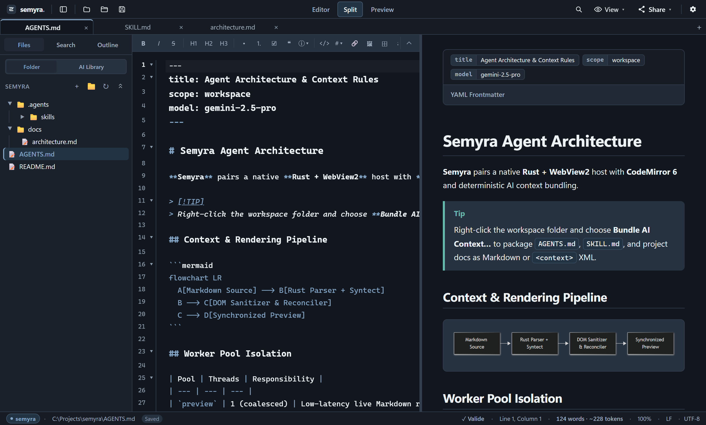

<div align="center">


# Semyra

**Markdown for the AI era.**  
Native Windows 11 Markdown viewer and editor for project documentation, prompts, skills (`SKILL.md`), and coding-agent instructions (`AGENTS.md`).

[](https://github.com/JanChrisLoew/semyra/releases/latest)
[](https://github.com/JanChrisLoew/semyra/releases/latest)
[](https://github.com/JanChrisLoew/semyra/actions/workflows/ci.yml)
[](https://github.com/JanChrisLoew/semyra)
[](LICENSE)

[**Download for Windows 11**](#download--installation) · [**Features**](#why-semyra) · [**AI Context Workflow**](#ai-context-bundling) · [**Shortcuts**](#keyboard-shortcuts) · [**Build from Source**](#building-from-source) · [**Deutsch**](#deutsch)

</div>

<br />

<picture>
  <source media="(prefers-color-scheme: dark)" srcset="assets/screenshot-dark.png" />
  <source media="(prefers-color-scheme: light)" srcset="assets/screenshot-light.png" />
  
</picture>

<div align="center">
  <sub><em>Semyra automatically adapts to Dark and Light themes, keeping the native Win32 titlebar, CodeMirror 6 editor, and Mermaid diagrams in sync.</em></sub>
</div>

---

## Why Semyra?

<table>
  <tr>
    <td width="50%" valign="top">
      <h3>⚡ Native Windows 11 Speed (~14 MB)</h3>
      <p>Built in <strong>Rust</strong> (<code>tao</code> / <code>wry</code> + Microsoft Edge WebView2) with isolated background worker pools for live preview rendering, workspace search, file dialogs, and crash-safe draft snapshots. No Electron bloat, no cloud account, 100% local.</p>
    </td>
    <td width="50%" valign="top">
      <h3>🧩 1-Click AI Context Bundling</h3>
      <p>Package open working tabs and closed workspace files (<code>AGENTS.md</code>, <code>SKILL.md</code>, architecture docs) with relative paths into deterministic <strong>Markdown</strong> or validated <strong><code>&lt;context&gt;</code> XML</strong> bundles — complete with live token estimates.</p>
    </td>
  </tr>
  <tr>
    <td width="50%" valign="top">
      <h3>📐 Rich Technical Markdown &amp; Diagrams</h3>
      <p>Synchronized scroll preview with GitHub-Flavored Markdown tables, task lists, alerts (<code>[!NOTE]</code>, <code>[!TIP]</code>), YAML frontmatter chips, footnotes, <strong>KaTeX</strong> math, and interactive zoom/pan <strong>Mermaid</strong> diagrams.</p>
    </td>
    <td width="50%" valign="top">
      <h3>🛡️ Crash-Safe Drafts &amp; File Fidelity</h3>
      <p>Per-window locked recovery snapshots under <code>%LOCALAPPDATA%\Semyra\drafts\</code>, external change line-diff inspection, version-guarded workspace search &amp; replace, and original encoding preservation (<code>UTF-8</code>, <code>BOM</code>, <code>UTF-16</code>, <code>Windows-1252</code>).</p>
    </td>
  </tr>
</table>

---

## Download & Installation

Download the latest release directly from [**GitHub Releases**](https://github.com/JanChrisLoew/semyra/releases/latest) — no account required:

| Package | Architecture | Direct Download | Description |
| --- | --- | --- | --- |
| **Windows Installer (Recommended)** | **x64** (Intel / AMD) | [**`Semyra-Setup-x64.exe`**](https://github.com/JanChrisLoew/semyra/releases/latest/download/Semyra-Setup-x64.exe) | Per-user installer with Start Menu shortcut, optional *"Open with Semyra"*, and folder context menu integration. |
| **Windows Installer (ARM64)** | **ARM64** (Snapdragon / Surface) | [**`Semyra-Setup-arm64.exe`**](https://github.com/JanChrisLoew/semyra/releases/latest/download/Semyra-Setup-arm64.exe) | Native ARM64 per-user installer for Windows on ARM devices. |
| **Portable Executable** | **x64** (Intel / AMD) | [**`Semyra-x64.exe`**](https://github.com/JanChrisLoew/semyra/releases/latest/download/Semyra-x64.exe) | Single self-contained `.exe` (embeds the entire frontend). Run directly without installation. |
| **Portable Executable (ARM64)** | **ARM64** (Snapdragon / Surface) | [**`Semyra-arm64.exe`**](https://github.com/JanChrisLoew/semyra/releases/latest/download/Semyra-arm64.exe) | Single self-contained native ARM64 `.exe`. |
| **SHA-256 Checksums** | x64 & ARM64 | [**`SHA256SUMS.txt`**](https://github.com/JanChrisLoew/semyra/releases/latest/download/SHA256SUMS.txt) | SHA-256 hashes for verifying downloaded binaries. |

> [!NOTE]
> **Windows Defender SmartScreen:** Because Semyra is distributed as a free open-source release without a commercial EV code-signing certificate, Windows SmartScreen may display *"Windows protected your PC"* on first launch. Click **"More info"** → **"Run anyway"** to proceed.
>
> **System Requirement:** Windows 11 with the [Microsoft Edge WebView2 Runtime](https://developer.microsoft.com/en-us/microsoft-edge/webview2/) (pre-installed on Windows 11).

---

## AI Context Bundling

Modern coding agents and LLMs rely on structured Markdown files (`AGENTS.md`, `SKILL.md`, architecture specs). Semyra lets you curate and export multi-file context packages in seconds:

1. **Open your project folder** (`Ctrl+Shift+O`) and edit or inspect your Markdown files.
2. **Right-click the workspace folder header** (or open the **Share** menu / `Ctrl+Shift+P`) and choose **Bundle AI Context…**.
3. **Select open tabs and closed workspace files**, optionally strip YAML frontmatter or HTML comments, and copy or save as **Markdown** or **XML (`<context>`)**:

```xml
<context>
  <file path="AGENTS.md">
# Project Rules &amp; Architecture
...
  </file>
  <file path=".agents/skills/code-review/SKILL.md">
# Code Review Checklist
...
  </file>
</context>
```

> [!TIP]
> You can also copy a single section directly from the **Outline** sidebar (complete with per-section token estimates) or press `Ctrl+Shift+A` to copy the active tab as AI context immediately.

---

## Export & Sharing

- **Standalone 1-File HTML (`Ctrl+Shift+H`):** Produces a self-contained HTML file with embedded theme styles, rendered KaTeX MathML, Mermaid SVGs, and base64-inlined local images — ready to share offline.
- **Native PDF Export (`Ctrl+Shift+D`) & Print (`Ctrl+P`):** Clean typography, vector diagrams, and automatic page-break rules.
- **Rich-Text Clipboard (`Ctrl+Shift+K`):** Copies formatted tables, headings, code blocks, and alerts with inline styles for pasting directly into **Microsoft Word, Outlook, or Teams**.

---

## Keyboard Shortcuts

<details open>
<summary><strong>Essential Keyboard Shortcuts (Click to toggle)</strong></summary>

<br />

| Shortcut | Action |
| --- | --- |
| `Ctrl+O` / `Ctrl+Shift+O` | Open file / Open workspace folder |
| `Ctrl+S` / `Ctrl+Shift+S` | Save / Save As |
| `Ctrl+E` | Quick Open for tabs and workspace files |
| `Ctrl+Shift+P` | Open Command Palette |
| `Ctrl+Shift+F` | Full-text Search & Replace in workspace folder |
| `Ctrl+Shift+A` | Copy active tab as AI context |
| `Ctrl+Shift+L` | Format Markdown document |
| `Ctrl+Shift+H` | Export standalone 1-file HTML |
| `Ctrl+Shift+D` | Export PDF document |
| `Ctrl+Shift+K` | Copy formatted Rich Text (Word / Outlook / Teams) |
| `Ctrl+P` | Print document |
| `Alt+1` / `Alt+2` / `Alt+3` | Editor only / Split view / Preview only |
| `Alt+Shift+S` | Toggle vertical / horizontal split orientation |
| `Alt+Z` | Toggle Zen Mode |

</details>

---

## Building from Source

Prerequisites: Windows 11, stable Rust toolchain (`x86_64-pc-windows-msvc`, plus optional `aarch64-pc-windows-msvc`), Microsoft Edge WebView2 Runtime, Node.js 22+ with npm, and [Inno Setup 6](https://jrsoftware.org/isinfo.php) (`ISCC.exe`) for building installers.

```powershell
# 1. Install frontend dependencies
npm --prefix frontend ci

# 2. Typecheck, run frontend & Rust unit tests, and build x64 Semyra.exe + x64 Installer
powershell -ExecutionPolicy Bypass -File .\scripts\Build-Release.ps1 -Installer

# 3. Optional: Run Playwright E2E & Accessibility tests
Push-Location frontend
npm run test:e2e
Pop-Location

# 4. Optional: Build both x64 and ARM64 Inno Setup installers
cargo build --release --locked --target aarch64-pc-windows-msvc
powershell -ExecutionPolicy Bypass -File .\scripts\Build-Installer.ps1 -Architecture all
```

---

<a id="deutsch"></a>

## Deutsch

**Markdown for the AI era.** Semyra ist ein schneller, lokaler Markdown-Viewer und -Editor für Windows 11 mit synchronisierter Live-Vorschau. Er hilft dir, Projektdokumentation, Prompts, Skills (`SKILL.md`) und Agentenanweisungen (`AGENTS.md`) zu bearbeiten, zu prüfen und gezielt als KI-Kontext weiterzugeben.

### Download & Installation (Windows 11)

Die aktuellen Installationspakete und portablen Programmdateien stehen direkt unter [**GitHub Releases**](https://github.com/JanChrisLoew/semyra/releases/latest) bereit (kein GitHub-Account erforderlich):

| Paket | Architektur | Direkt-Download | Beschreibung |
| --- | --- | --- | --- |
| **Windows-Installer (Empfohlen)** | **x64** (Intel / AMD) | [**`Semyra-Setup-x64.exe`**](https://github.com/JanChrisLoew/semyra/releases/latest/download/Semyra-Setup-x64.exe) | Benutzer-Setup inkl. Startmenü-Eintrag sowie optionaler Integration für *„Öffnen mit“* und das Ordner-Kontextmenü. |
| **Windows-Installer (ARM64)** | **ARM64** (Snapdragon / Surface) | [**`Semyra-Setup-arm64.exe`**](https://github.com/JanChrisLoew/semyra/releases/latest/download/Semyra-Setup-arm64.exe) | Natives ARM64-Setup für Windows-on-ARM-Geräte. |
| **Portable Einzeldatei** | **x64** (Intel / AMD) | [**`Semyra-x64.exe`**](https://github.com/JanChrisLoew/semyra/releases/latest/download/Semyra-x64.exe) | Eigenständige `.exe` (enthält das gesamte Frontend) zum Direktstart ohne Installation. |
| **Portable Einzeldatei (ARM64)** | **ARM64** (Snapdragon / Surface) | [**`Semyra-arm64.exe`**](https://github.com/JanChrisLoew/semyra/releases/latest/download/Semyra-arm64.exe) | Eigenständige native ARM64-`.exe` ohne Installation. |
| **SHA-256-Prüfsummen** | x64 & ARM64 | [**`SHA256SUMS.txt`**](https://github.com/JanChrisLoew/semyra/releases/latest/download/SHA256SUMS.txt) | SHA-256-Hashes zur Integritätsprüfung der Downloads. |

> [!NOTE]
> **Hinweis zu Windows Defender SmartScreen:** Da Semyra als freies Open-Source-Projekt ohne kommerzielles Code-Signing-Zertifikat veröffentlicht wird, zeigt Windows beim ersten Start ggf. die Meldung *„Der Computer wurde durch Windows geschützt“*. Klicke auf **„Weitere Informationen“** → **„Trotzdem ausführen“**, um das Setup oder die App zu starten.

### Wichtigste Funktionen im Überblick

- **Editor und synchronisierte Vorschau** mit Gliederung samt Token-Schätzung pro Abschnitt, GFM-Tabellen, Aufgabenlisten, Hinweiskästen (`[!NOTE]`, `[!TIP]`), YAML-Frontmatter-Chips, Fußnoten, KaTeX-Formeln und interaktiven Mermaid-Diagrammen. Bilder lassen sich direkt aus der Zwischenablage oder per Drag-and-drop einfügen.
- **KI-Kontext bündeln & prüfen:** Rechtsklick auf den Arbeitsordner → **KI-Kontext bündeln…** fasst ausgewählte offene Tabs und ungeöffnete Projektdateien (`AGENTS.md`, `SKILL.md`, Dokumentation) mit relativen Pfaden als Markdown oder validiertes `<context>`-XML-Paket zusammen. Inklusive lokaler KI-Bibliothek, Variablen-Vorlagen und eingebautem Markdown-/`SKILL.md`-Linter.
- **Ordnersuche, Sitzung & Dateisicherheit:** Volltextsuche und versionsgesichertes Ersetzen (`Strg+Umschalt+F`, inkl. Regex und Ganzwort-Option), Zeilen-Diff-Ansicht bei externen Dateiänderungen, optionales Auto-Save sowie absturzsichere Entwurfswiederherstellung unter `%LOCALAPPDATA%\Semyra\drafts\`. Erhält bestehende Dateikodierungen (`UTF-8`, `UTF-8 mit BOM`, `UTF-16 LE/BE`, `Windows-1252`).
- **Export und Teilen:** Eigenständige 1-Datei-HTML-Exporte (mit eingebetteten lokalen Bildern), nativer PDF-Export, Drucklayout oder formatierter Rich-Text für Word, Outlook und Teams. Vollständig auf Deutsch und Englisch sowie im Dark- und Light-Theme nutzbar.

<details>
<summary><strong>Wichtige Tastenkürzel (Deutsch)</strong></summary>

<br />

| Tastenkürzel | Aktion |
| --- | --- |
| `Strg+O` / `Strg+Umschalt+O` | Datei öffnen / Arbeitsordner öffnen |
| `Strg+S` / `Strg+Umschalt+S` | Speichern / Speichern unter |
| `Strg+E` | Schnellwahl für Tabs und Dateien |
| `Strg+Umschalt+P` | Befehlspalette öffnen |
| `Strg+Umschalt+F` | Arbeitsordner durchsuchen & ersetzen |
| `Strg+Umschalt+A` | Aktiven Tab als KI-Kontext kopieren |
| `Strg+Umschalt+L` | Markdown formatieren |
| `Strg+Umschalt+H` | Eigenständige HTML-Datei exportieren |
| `Strg+Umschalt+D` | PDF-Datei exportieren |
| `Strg+Umschalt+K` | Formatierten Text kopieren |
| `Strg+P` | Druckdialog öffnen |
| `Alt+1` / `Alt+2` / `Alt+3` | Editor / geteilte Ansicht / Vorschau |

</details>

---

## License / Lizenz

Released under the [MIT License](LICENSE). Copyright (c) 2026 Semyra Contributors.
